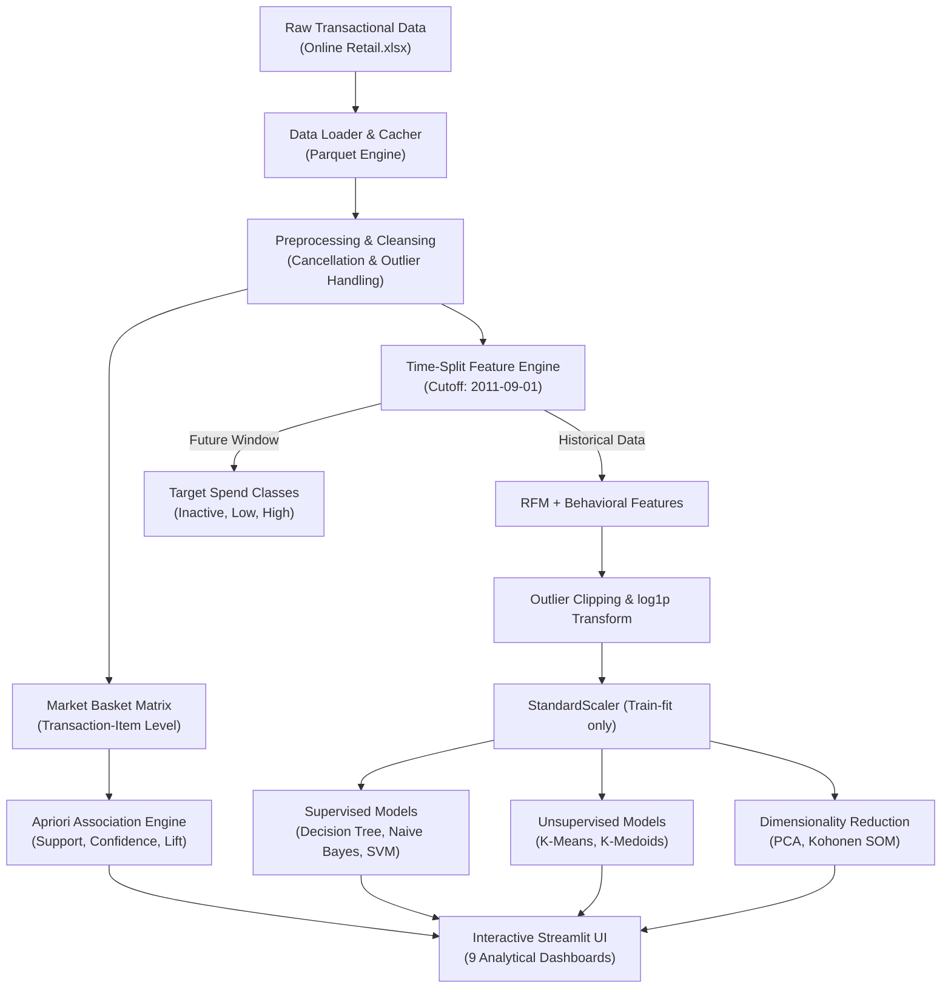

# 🛒 Intelligent Retail Customer Behavior Prediction and Segmentation System

[](https://www.python.org/)
[](https://streamlit.io/)
[](https://scikit-learn.org/)
[]()

An end-to-end Data Science & Analytics (DSA) platform that transforms raw transactional e-commerce data into actionable customer intelligence. The system combines strict **leakage-free feature engineering**, **supervised machine learning**, **unsupervised customer clustering**, **market basket association rules**, and **topological neural maps (SOM)** into an interactive **Streamlit** web application.

---

## 📌 Table of Contents
- [Executive Overview](#-executive-overview)
- [Key Features & Modules](#-key-features--modules)
- [System Architecture](#-system-architecture)
- [Dataset Details](#-dataset-details)
- [Project Directory Structure](#-project-directory-structure)
- [Installation & Quickstart](#-installation--quickstart)
- [Running the Application](#-running-the-application)
- [Testing & Verification](#-testing--verification)
- [Machine Learning & Analytics Methodology](#-machine-learning--analytics-methodology)
- [Tech Stack](#-tech-stack)

---

## 🌟 Executive Overview

Retailers often struggle to identify which customers are at risk of churn, which will become high-value buyers, and which products are frequently co-purchased. This project provides a production-grade analytics platform addressing these challenges:

- **Customer Lifetime Prediction:** Classifies future customer purchasing activity (*Inactive*, *Low/Medium Value*, *High Value*).
- **Targeted Segmentation:** Groups customers into behavioral personas (*Champions*, *Loyal*, *At Risk*, *Dormant*) to tailor marketing strategies.
- **Product Association Rules:** Uncovers co-purchase patterns with the Apriori algorithm to drive cross-selling and product bundling.
- **Topological & Dimensional Analysis:** Visualizes complex multi-dimensional customer profiles using PCA and Self-Organizing Maps (SOM).
- **Zero Data Leakage:** Implements a strict time-based split where features are computed exclusively before a temporal cutoff date and target labels are derived exclusively after it.

---

## 🚀 Key Features & Modules

### 1. 📊 Executive Dashboard
- Real-time KPIs: Cleaned Transaction Volume, Unique Customers, Catalog Size, Total Net Revenue.
- Revenue over time trends and temporal patterns.
- Top 5 revenue-generating countries and top-selling products.

### 2. 🧹 Data Cleaning & Preprocessing Pipeline
- Handles cancellations (negative quantities and `C`-prefixed invoices) and invalid unit prices.
- Removes unassigned `CustomerID` records while preserving transaction logs.
- Robust outlier management via 1st and 99th percentile capping.
- Log-transformation (`log1p`) on highly skewed RFM features to satisfy model normality assumptions.
- Caching layer via Apache Parquet for near-instant dataset reloads.

### 3. 🎯 Customer Behavior Prediction (Supervised Learning)
- Predicts customer future value tier using three distinct algorithms:
  - **Decision Tree Classifier** (interpretable decision boundaries & feature importance).
  - **Gaussian Naive Bayes** (fast probabilistic baseline).
  - **Support Vector Machine (SVM)** (RBF kernel with Platt scaling for well-calibrated class probabilities).
- Interactive customer profiling simulator for real-time what-if scenario testing.

### 4. 📈 Model Comparison & Diagnostics
- 5-Fold Stratified Cross-Validation for unbiased performance comparison.
- Multi-class Confusion Matrices, Precision, Recall, and F1-Scores.
- Feature importance analysis highlighting Recency, Monetary Value, and Frequency as key predictive drivers.

### 5. 👥 Customer Segmentation (Unsupervised Learning)
- **K-Means** and **K-Medoids** clustering on scaled RFM and behavioral metrics.
- Automatic Elbow Method and Silhouette Analysis across multiple $K$ values.
- Automated persona labeling comparing cluster centroids to population medians:
  - *Champions*: High frequency, recent purchases, high total spend.
  - *Loyal Customers*: Moderate-to-high frequency, steady spend.
  - *At Risk*: High historical spend, but high recency (dormant).
  - *Occasional / Low Value*: Infrequent, low spend.

### 6. 🛒 Market Basket Analysis (Association Rules)
- Transaction-level matrix encoding with the **Apriori algorithm** (`mlxtend`).
- Filtering by minimum **Support**, **Confidence**, and **Lift**.
- Identifies cross-selling opportunities and high-affinity product pairs.

### 7. 🧬 Dimensionality Reduction & Topological Maps
- **Principal Component Analysis (PCA):** 2D projections explaining maximum feature variance.
- **Self-Organizing Maps (SOM / Kohonen Networks):** Non-linear 2D topological mapping using `minisom`:
  - **U-Matrix (Unified Distance Matrix):** Visualizes cluster boundaries and density.
  - **Dominant Class Map:** Overlays supervised labels onto unsupervised topological nodes.

---

## 🏗️ System Architecture



---

## 📂 Dataset Details

The system utilizes the **UCI Machine Learning Repository - Online Retail Dataset** (Dataset ID 352):
- **Origin:** Non-store online retail based in the United Kingdom.
- **Timeframe:** 01/12/2010 to 09/12/2011.
- **Volume:** ~541,909 raw records containing InvoiceNo, StockCode, Description, Quantity, InvoiceDate, UnitPrice, CustomerID, Country.
- **Local Storage:** Stored in `retail_customer_intelligence/data/Online Retail.xlsx` and cached as high-speed `retail_customer_intelligence/data/online_retail.parquet`.

---

## 📁 Project Directory Structure

```text
DSA project/
├── retail_customer_intelligence/
│   ├── data/
│   │   ├── Online Retail.xlsx         # Original UCI dataset
│   │   └── online_retail.parquet      # Cached Parquet file for high-speed I/O
│   ├── src/
│   │   ├── __init__.py
│   │   ├── data_loader.py             # Dual Excel/Parquet loader with fallback
│   │   ├── preprocessing.py          # Data cleansing, outlier bounds & transforms
│   │   ├── feature_engineering.py    # Strict time-split RFM feature computation
│   │   ├── classification.py         # Decision Tree, Naive Bayes, SVM pipelines
│   │   ├── clustering.py             # K-Means, K-Medoids & persona interpretation
│   │   ├── association.py            # Basket matrix builder & Apriori rules
│   │   ├── pca_analysis.py           # PCA dimensionality reduction
│   │   ├── som_analysis.py           # MiniSom Kohonen network training & plots
│   │   └── visualization.py          # Reusable Matplotlib/Seaborn visualization suite
│   ├── models/                       # Directory for serialized models
│   ├── outputs/                      # Generated figures and reports
│   ├── app.py                        # Multi-page Streamlit application
│   ├── profile.py                    # Dataset profiling and statistics script
│   ├── requirements.txt              # Core project dependencies
│   ├── verify_all.py                 # Comprehensive automated verification suite
│   ├── test_phase2.py                # Verification for data cleansing & preprocessing
│   ├── test_phase3.py                # Verification for feature engineering & time-split
│   ├── test_phase4.py                # Verification for classification models
│   ├── test_phase5.py                # Verification for clustering & segmentation
│   ├── test_phase6.py                # Verification for association, PCA & SOM
│   ├── PRESENTATION_MATERIAL.md      # Viva preparation guide & presentation script
│   └── SPEC.md                       # Comprehensive system technical specification
├── .gitignore                        # Git ignore specifications
└── README.md                         # Project documentation
```

---

## ⚙️ Installation & Quickstart

### Prerequisites
- **Python:** Version `3.10` or `3.11` is strongly recommended.
- **Git:** Version 2.x+

### 1. Clone the Repository
```bash
git clone <your-repository-url>
cd <repository-directory>
```

### 2. Navigate to Project Directory & Setup Environment
```bash
cd retail_customer_intelligence
```

- **Windows (Command Prompt / PowerShell):**
  ```powershell
  python -m venv .venv
  .venv\Scripts\activate
  ```
- **macOS / Linux:**
  ```bash
  python3 -m venv .venv
  source .venv/bin/activate
  ```

### 3. Install Dependencies
```bash
pip install --upgrade pip
pip install -r requirements.txt
```

---

## 💻 Running the Application

Launch the Streamlit interactive dashboard:

```bash
streamlit run app.py
```
*(Or from the root directory: `streamlit run retail_customer_intelligence/app.py`)*

The application will start locally at:
👉 **`http://localhost:8501`**

Use the left sidebar navigation to explore the 9 interactive analytical modules.

---

## 🧪 Testing & Verification

Run the comprehensive test suite to verify all analytical pipelines:

```bash
cd retail_customer_intelligence
python verify_all.py
```

To run individual phase test scripts:
```bash
python test_phase2.py   # Preprocessing & Data Cleaning
python test_phase3.py   # Feature Engineering & Time-Split
python test_phase4.py   # Supervised Classification
python test_phase5.py   # Clustering & Segmentation
python test_phase6.py   # Market Basket, PCA & SOM
```

---

## 🔬 Machine Learning & Analytics Methodology

### Data Leakage Prevention
To guarantee valid evaluation in retail time-series data:
1. **Cutoff Date:** `2011-09-01`.
2. **Feature Window:** Only transactions **before** the cutoff date are aggregated to compute Recency, Frequency, Monetary (RFM), and behavior indicators.
3. **Target Window:** Only transactions **after** the cutoff date are used to define future customer spend tier.
4. **Scaler Isolation:** Feature scalers are fit strictly on the training partition and applied to validation/test partitions without peeking.

### Feature Normalization & Outlier Strategy
- Outliers in heavy-tailed features (`Monetary`, `Frequency`, `TotalQuantity`) are capped at the 1st and 99th empirical percentiles.
- A $\log(1 + x)$ (`log1p`) transformation is applied to normalize skewed distributions for linear and distance-sensitive algorithms.

---

## 🛠️ Tech Stack

- **Application & Dashboard:** [Streamlit](https://streamlit.io/)
- **Core Data Science:** [Pandas](https://pandas.pydata.org/), [NumPy](https://numpy.org/)
- **Machine Learning:** [Scikit-learn](https://scikit-learn.org/), [scikit-learn-extra](https://scikit-learn-extra.readthedocs.io/)
- **Association Rule Mining:** [Mlxtend](http://rasbt.github.io/mlxtend/)
- **Neural Self-Organizing Maps:** [MiniSom](https://github.com/JustGlowing/minisom)
- **Data Visualization:** [Matplotlib](https://matplotlib.org/), [Seaborn](https://seaborn.pydata.org/)
- **Storage & Serialization:** [PyArrow (Parquet)](https://arrow.apache.org/docs/python/), [OpenPyXL](https://openpyxl.readthedocs.io/)
