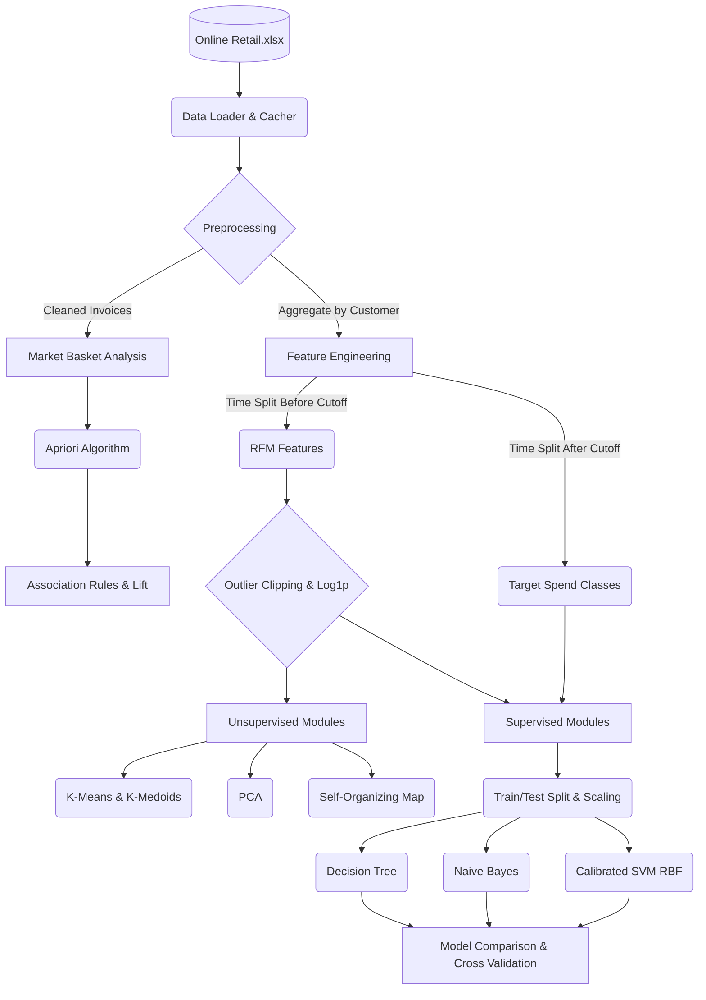

# Presentation Material & Viva Guide

## 1. Demo Script (5-10 Minutes)

**Step 1: Introduction**
"Hello, my project is an Intelligent Retail Customer Behavior Prediction and Segmentation System. The goal is to ingest messy transactional data, extract customer RFM profiles, segment them to find marketing personas, and predict their future spend category."

**Step 2: Dashboard & Dataset**
"If we look at the Dataset & Preprocessing page, you can see how we handle dirty data. We remove cancelled invoices, invalid prices, and clip outliers at the 1st and 99th percentiles. We apply a log1p transform to skewed features like Monetary and Frequency. It's important to note that our features are built *strictly* from data before our cutoff date of 2011-09-01, and our target class is calculated *after* this date to completely prevent data leakage."

**Step 3: Customer Behavior Prediction**
"Here, we predict whether a customer will be Inactive, Low/Medium, or High value in the future. I can input a customer profile, and our three models (Decision Tree, Naive Bayes, and SVM) will predict the class. Notice the SVM uses Platt scaling to give confidence probabilities. If I enter a 'Likely Inactive' profile, all models accurately predict Inactive."

**Step 4: Model Comparison**
"Moving to Model Comparison, we evaluate the models using 5-fold stratified cross-validation. The Decision Tree gets around 57% accuracy, while the SVM achieves ~58.5%. While this isn't 100%, it beats the majority-class baseline. We can also see the Decision Tree feature importances here, showing that Recency and Monetary value are the strongest predictors."

**Step 5: Customer Segmentation (Unsupervised)**
"In the Segmentation module, we group customers without pre-defined labels. Using K-Means and K-Medoids, we see the best Silhouette score is at K=2, but we chose K=4 for interpretability. The app automatically assigns business logic labels to the clusters based on overall feature medians, such as 'Champions' or 'Dormant'."

**Step 6: Product Association Analysis**
"For market basket analysis, we use the Apriori algorithm on raw invoice data. With a minimum support of 0.02 and confidence of 0.5, we found 129 rules. The top rule by lift shows exactly which products are most frequently bought together, providing cross-selling opportunities."

**Step 7: PCA & SOM**
"Finally, we use PCA to reduce the dimensionality of our data to 2D, keeping 2 components. We also use a Self-Organizing Map (SOM) to topologically map similar customers near each other on a grid. The U-matrix shows boundaries between these groups, and the Dominant Class map reveals that the unsupervised SOM naturally clusters High-value and Inactive customers into their own distinct regions."

---

## 2. Viva Q&A Guide

**Q: How did you prevent Data Leakage?**
**A:** We used a strict time-split. Features (Recency, Frequency, Monetary) were calculated ONLY using transactions before September 1, 2011. The Target label (Inactive, Low, High) was calculated ONLY using transactions after that date. Furthermore, our scaler is fit strictly on the training set.

**Q: Why is your model accuracy only around 58%? Is that bad?**
**A:** No, 58% is actually good for this domain. Predicting human purchasing behavior is inherently noisy. Our baseline model (predicting the majority class every time) is much lower. 58% proves the models are learning real, generalizable patterns rather than memorizing the data.

**Q: Why clip outliers?**
**A:** Distance-based algorithms (like K-Means and SVM) and variance-based algorithms (like PCA) are highly sensitive to extreme outliers. We clipped at the 1st and 99th percentiles to ensure the models learned from the general population, not just a few massive wholesalers.

**Q: Why use a log1p transform?**
**A:** Features like Monetary and Frequency are heavily right-skewed (most people spend a little, few spend a lot). `log1p` pulls these extreme long tails into a normal, bell-shaped distribution, which algorithms like Gaussian Naive Bayes and K-Means assume.

**Q: What is the difference between Classification and Clustering here?**
**A:** Classification (Decision Tree, SVM, Naive Bayes) is supervised; it uses historical data to predict a known future label. Clustering (K-Means, K-Medoids) is unsupervised; it groups customers based purely on feature similarity without knowing any future label.

**Q: How did you interpret the clusters?**
**A:** K-Means does not inherently know what a "VIP" is. It just returns groups. We interpreted the clusters by comparing the mean Recency, Frequency, and Monetary of each cluster against the overall dataset medians to assign descriptive tags.

**Q: PCA vs SOM?**
**A:** Both are used for dimensionality reduction and visualization here. PCA is a linear projection that finds axes of maximum variance. SOM is a non-linear neural network that maps data onto a 2D topological grid, preserving local neighborhoods (similar customers end up in adjacent nodes).

**Q: How did you calculate the Lift in Apriori?**
**A:** Lift is the Confidence of the rule divided by the Support of the consequent. It measures how much more likely the items are bought together than if they were statistically independent. A lift > 1 means they are positively correlated.

---

## 3. Architecture Pipeline Diagram

---

## 4. Screenshot Checklist

- [ ] **Dashboard:** Showing overview numbers and charts.
- [ ] **Dataset & Preprocessing:** Showing the Outlier table and Target definition cutoff logic.
- [ ] **Customer Behavior Prediction:** Showing a prediction using the "Likely Inactive" example profile.
- [ ] **Model Comparison:** Showing the detailed metrics table with Cross-Validation scores and the bar chart.
- [ ] **Model Comparison:** Showing the Decision Tree Feature Importance chart.
- [ ] **Customer Segmentation:** Showing the Silhouette plot and the K-Means vs K-Medoids comparison text.
- [ ] **Product Association:** Showing the "Top 10 Rules by Lift" bar chart.
- [ ] **PCA Visualization:** Showing the 2D scatter plot colored by Cluster.
- [ ] **SOM Visualization:** Showing the 4 maps (U-Matrix, Hit Map, Dominant Cluster, Dominant Class).

---

## 5. PPT Outline

**Slide 1: Title Slide**
- Intelligent Retail Customer Behavior Prediction and Segmentation System
- Name, Course, Date

**Slide 2: Problem Statement**
- Objective: Transform messy transaction data into actionable customer intelligence.
- Tasks: Predict future spend, segment marketing personas, and discover product associations.

**Slide 3: Data Preprocessing & Leakage Control**
- Time-Split Design: Features derived before cutoff date; target derived after.
- Outlier Handling: 1st-99th percentile clipping.
- Skewness Handling: log1p transformations.

**Slide 4: Customer Behavior Prediction**
- Models: Decision Tree, Naive Bayes, SVM (RBF).
- Results: ~58% accuracy beating majority-class baseline.
- Feature Importance: Recency and Monetary drive the predictions.

**Slide 5: Customer Segmentation**
- Algorithms: K-Means vs K-Medoids.
- Best K: Evaluated using Silhouette and Elbow methods.
- Interpretation: Automated rule-based labeling of clusters (e.g. Champions, Dormant).

**Slide 6: Market Basket Analysis**
- Algorithm: Apriori on invoice data.
- Metrics: Support, Confidence, Lift.
- Output: Actionable cross-selling rules.

**Slide 7: Dimensionality Reduction (PCA & SOM)**
- PCA: Linear reduction preserving variance (scatter plots).
- SOM: Non-linear neural network preserving topology (hit maps, U-matrix).

**Slide 8: Conclusion & Future Work**
- System successfully categorizes and predicts behavior.
- Future work: Deep learning for sequences (LSTMs), deployment via REST API.

---

## 6. Project Report Outline

1. **Introduction:** Domain context, objectives, dataset description.
2. **Data Preprocessing:** Cleaning steps, handling missing values, time-split methodology for leakage prevention.
3. **Feature Engineering:** Derivation of RFM features, handling skewness (log1p), outlier clipping, standardization.
4. **Supervised Learning (Classification):** 
   - Decision Trees, Naive Bayes, SVM theory.
   - Cross-validation setup, evaluation metrics (Accuracy, F1).
   - Results and Model Comparison.
5. **Unsupervised Learning (Clustering):**
   - K-Means and K-Medoids implementations.
   - Elbow and Silhouette methods for determining K.
   - Cluster profiling and persona interpretation.
6. **Market Basket Analysis:** Apriori algorithm setup and top association rules.
7. **Dimensionality Reduction:** 
   - PCA (Explained variance, loadings).
   - SOM (MiniSom implementation, topographic errors, neighborhood mapping).
8. **UI Integration:** Streamlit dashboard design and user flow.
9. **Conclusion & Limitations.**
10. **References.**
